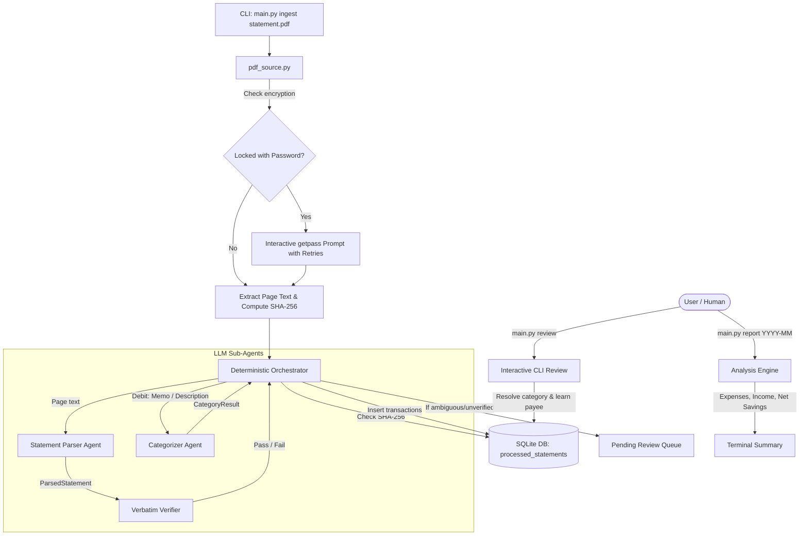
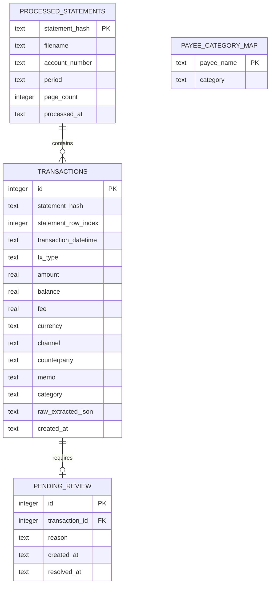

# System Architecture

Technical design specification for the KBank Bank Statement PDF Finance Tracker.

---

## 1. Architectural Philosophy

Financial tracking requires **exact numerical integrity**. Standard autonomous multi-agent systems often introduce errors when LLMs summarize, retype, or calculate figures across multiple conversation turns.

This project implements a **Hybrid Deterministic Architecture**:
1. **Deterministic Python Core**: PDF reading, decryption with interactive retry prompts, page chunking, deduplication checksums (SHA-256), and database writes are executed strictly in deterministic Python.
2. **Constrained Sub-Agents (`deepagents`)**: Language models are invoked only for tasks requiring semantic comprehension:
   - **Parser Sub-Agent**: Translates unstructured PDF page text into structured `ParsedStatement` transaction lists.
   - **Categorizer Sub-Agent**: Interprets user memos and merchant descriptions into a fixed spending taxonomy.
3. **Verbatim Validation Barrier**: No financial amount, date, or balance from an LLM is accepted without programmatic confirmation that the exact substring exists in the source page text.

---

## 2. Ingestion Pipeline & Data Flow

When `python main.py ingest <statement.pdf>` executes:

### Step 1: PDF Extraction & Decryption (`finance_tracker/pdf_source.py`)
- Reads the PDF file using `pypdf`.
- Computes SHA-256 file checksum for idempotency.
- If the PDF is password-protected:
  - Tries password provided via `--password` if any.
  - If omitted or incorrect, securely prompts the user in the terminal via `getpass.getpass` with retry availability.
- Extracts raw text per page.

### Step 2: Deduplication Check
- Checks `processed_statements` table for the file's SHA-256 checksum.
- If already processed, skips immediately, preventing duplicate transaction entries and avoiding LLM API costs.

### Step 3: LLM Parsing (`finance_tracker/agents/parser_agent.py`)
- For each page, passes text to the Parser Sub-Agent powered by `deepagents.create_deep_agent`.
- Returns a structured `ParsedStatement` containing `StatementTransaction` items:
  - `raw_date`, `raw_time`
  - `tx_type`: `"debit"` (withdrawal/expense) or `"credit"` (deposit/income)
  - `raw_amount`
  - `raw_balance`
  - `channel` (e.g. `K PLUS`, `EDC`, `ATM`, `TRFR`)
  - `description`, `memo`

### Step 4: Verbatim Verification (`verify_statement_tx_verbatim`)
- Verifies that `raw_amount`, `raw_date`, and `raw_balance` exist verbatim within the source page text.
- **If verification passes**: Proceeds to categorization.
- **If verification fails**: The amount is deemed untrustworthy. A transaction record is created with `amount = 0.0`, and an entry is pushed to `pending_review` alerting the user that verbatim verification failed.

### Step 5: Categorization Hierarchy
Categorization evaluates in strict order of priority for debit (expense) transactions:
1. **Memo Analysis**: If `tx.memo` is present, invoke `categorize_from_memo(tx.memo, tx.description)`.
2. **Payee Mapping**: If no memo exists, query `payee_category_map` for `tx.description`. If previously mapped, apply that category.
3. **Description Classification**: If not mapped, LLM attempts classification on description; if confidence $\ge 0.7$, category is accepted.
4. **Review Escalation**: If low confidence or unmapped, mark as `Uncategorized` and push to `pending_review`.
5. **Credit Transactions**: Automatically categorized under `Transfers` (or income).

### Step 6: Database Persistence
- Writes records to `transactions` table with `statement_hash` and `statement_row_index`.
- If marked for review, writes record to `pending_review`.
- Records file checksum in `processed_statements`.

---

## 3. Database Schema (`finance_tracker/db.py`)

---

## 4. On-Demand Analysis Engine (`finance_tracker/analysis.py`)

The analysis engine is decoupled from ingestion:
- Triggered on demand via `main.py report <YYYY-MM>`.
- Aggregates transactions for the requested year-month:
  - **Spending by Category**: Expenses (debit) grouped and sorted with percentage share.
  - **Total Expenses**: Sum of all debit transactions.
  - **Total Income**: Sum of all credit/deposit transactions.
  - **Net Savings**: Net difference (`Total Income - Total Expenses`).

---

## 5. Error Handling & Safety Measures

| Potential Failure | System Mitigation |
| :--- | :--- |
| **Password Protected PDF** | Interactive `getpass` prompt with retry availability; never stored in shell history. |
| **LLM Hallucinates Amount/Date** | `verify_statement_tx_verbatim` checks source page text. Mismatches are rejected (`amount=0.0`) and quarantined to `pending_review`. |
| **Duplicate Statement Upload** | SHA-256 file checksum prevents re-ingestion of identical files. |
| **Unrecognized Date Format** | `_normalize_datetime` supports diverse Thai bank formats without guessing. Unparseable dates trigger review. |
| **Ambiguous Transactions** | Filtered through `pending_review` where the user classifies them once and saves a permanent rule to `payee_category_map`. |
